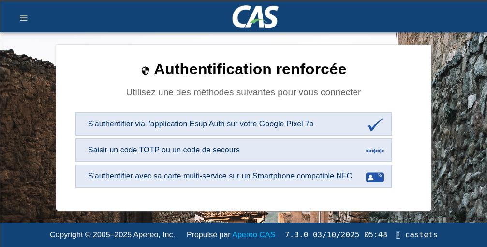
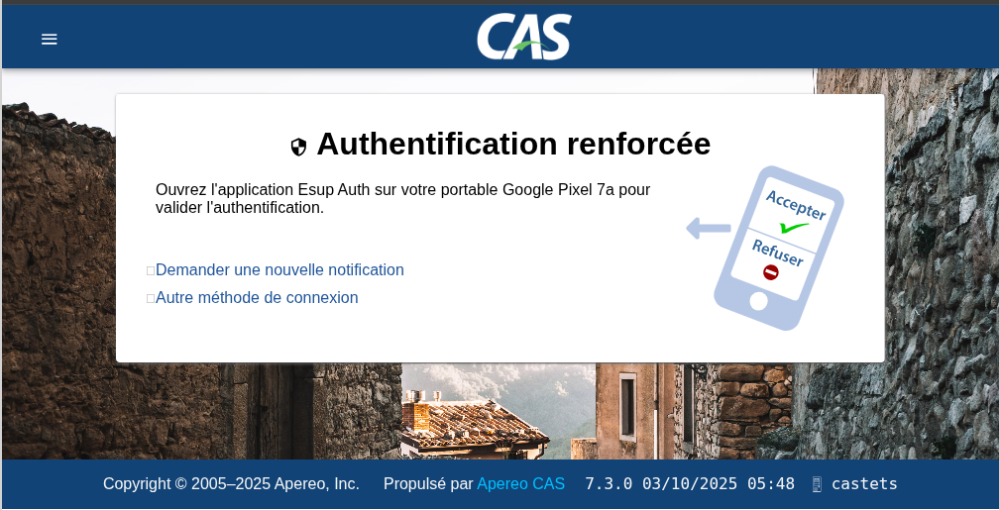

# ESUP-OTP-CAS

ESUP-OTP-CAS is a multifactor authentication provider for [Apereo CAS](https://github.com/apereo/cas). This branch targets CAS 8.1.0-RC3.

For older versions of CAS, please check the branch corresponding to your CAS version : 
* for CAS 8.0.x, check branch [8.0.x](https://github.com/EsupPortail/esup-otp-cas/tree/8.0.x)
* for CAS 7.3.x, check branch [7.3.x](https://github.com/EsupPortail/esup-otp-cas/tree/7.3.x)
* for CAS 7.2.x, check branch [7.2.x](https://github.com/EsupPortail/esup-otp-cas/tree/7.2.x)

Requires [esup-otp-api](https://github.com/EsupPortail/esup-otp-api/) v2.2.3 or later.

## Config

### cas.properties

add the following:

```
# MFA Esup Otp Authentication
cas.authn.mfa.triggers.global.global-provider-id=mfa-esupotp

# Add translations, you will need to check what are the default from CAS "Message Bundles" properties
cas.messageBundle.baseNames=classpath:custom_messages,classpath:messages,classpath:esupotp_message

# Add your esup-otp-api in Content-Security-Policy:
cas.http-web-request.header.content-security-policy=script-src 'self' 'unsafe-inline' 'unsafe-eval' https://esup-otp-api.example.org/; object-src 'none'; worker-src 'self' blob: 'unsafe-inline'
```
If you want to trust devices for 7 days, you can add this in cas.properties
```
cas.authn.mfa.trusted.core.device-registration-enabled=true                                                                                                                                         
cas.authn.mfa.trusted.core.auto-assign-device-name=true
cas.authn.mfa.trusted.device-fingerprint.cookie.max-age=P7D
```
with auto-assign-device-name, user will not have to choose a name for his device in a web form, it will be automatically assigned.  

### esupotp.properties

Create esupotp.properties in same directory as cas.properties
```
##
# Esup Otp Authentication
#
esupotp.rank=0
esupotp.connection-timeout=PT10S
esupotp.read-timeout=PT10S
esupotp.urlApi=https://esup-otp-api.example.org
esupotp.usersSecret=changeit
esupotp.apiPassword=changeit
esupotp.byPassIfNoEsupOtpMethodIsActive=false
esupotp.otpManagerUrl=https://esup-otp-manager.univ.fr/
esupotp.failureMode=CLOSED
```

CAS and the user's browser must both be able to reach `esupotp.urlApi`. The browser loads the MFA page's JavaScript and CSS from this URL. Use an HTTPS URL when CAS is served over HTTPS and include the API origin in the CAS Content Security Policy as shown above.

Set `esupotp.usersSecret` and `esupotp.apiPassword` to the values of `users_secret` and `api_password` in the API configuration.

`esupotp.byPassIfNoEsupOtpMethodIsActive` defaults to `true`, which allows users with no active OTP method to skip MFA. The example sets it to `false` to disable that bypass.

HTTP timeouts use Java Duration syntax (for example `PT10S` or `PT0.5S`) and must be at least one millisecond. The connection timeout also bounds waiting for a pooled connection. The read timeout bounds waiting for the response and socket inactivity; it is not a total request deadline. Changes apply when the service is recreated (normally on restart). Requests are not retried automatically and redirects are rejected.

In esupotp.properties you can also use usual Multifactor Authentication Bypass configurations described here https://apereo.github.io/cas/8.0.x/mfa/Configuring-Multifactor-Authentication-Bypass.html

So for example you can setup bypass with groovy script :
```
esupotp.bypass.groovy.location=file:/etc/cas/config/mfaGroovyBypass.groovy
```

/etc/cas/config/mfaGroovyBypass.groovy :
``` groovy
import java.util.*

def boolean run(authentication, principal, registeredService, provider, logger, httpRequest, ... other_args) {

    if(registeredService.id == 10 && "cn=for.appli-sensible.supervisor,ou=groups,dc=example,dc=org" in principal.attributes.memberOf) {
      return true;
    }

    return false;
}
```

### cas/build.gradle

The example uses the `v2.3.0-cas_v8.1.x` release coordinate. Check its availability on [Maven Central](https://central.sonatype.com/artifact/org.esup-portail/esup-otp-cas) before using it. The source version for this checkout is `v2.3.1-cas_v8.1.x-SNAPSHOT`, as declared in [gradle.properties](gradle.properties).

add
``` groovy
...

dependencies {
    ...
    implementation "org.esup-portail:esup-otp-cas:v2.3.0-cas_v8.1.x"
}
```

### log4j2.xml

add
```
<AsyncLogger name="org.esupportail.cas.adaptors.esupotp" level="debug" additivity="false" includeLocation="true">
    <AppenderRef ref="casConsole"/>
    <AppenderRef ref="casFile"/>
</AsyncLogger>
```

### JitPack

Use the example below only for builds available on [JitPack](https://jitpack.io/#EsupPortail/esup-otp-cas). This branch requires JDK 25, and the current [JitPack configuration](jitpack.yml) selects OpenJDK 21. For this checkout, use the local build instructions below.

Add in cas/build.gradle
``` groovy
...
repositories {
    ...
    maven {
        url "https://jitpack.io"
    }
}
...

dependencies {
    ...
    implementation "com.github.EsupPortail:esup-otp-cas:master"
}
```

### Local build

Build locally with JDK 25.
```
./gradlew clean build
```

## publishing on central maven repository

This part is only for developers, if you want to publish on central maven repository, you need to have a sonatype account and be a member of the group org.esup-portail. 

ESUP-OTP-CAS uses the JReleaser plugin to publish to Maven Central.

You have to configure also your ~/.jreleaser/config.yml file with your sonatype credentials.

See https://jreleaser.org/guide/latest/examples/maven/maven-central.html#_gradle

Set the release version in `gradle.properties`, then run the following command with JDK 25.
```
./gradlew clean build publish jreleaserFullRelease
```

## development environment with docker

The development stack requires Docker Compose and host networking. Use Docker Engine on Linux or enable host networking in Docker Desktop 4.34 or later. [Docker host networking documentation](https://docs.docker.com/engine/network/drivers/host/)

For that, run
```
docker compose -f src/etc/docker-compose.yml up
``` 

Next, you can access esup-otp-manager on http://localhost:4000/
It will be redirected to CAS for authentication on http://localhost:8080/cas/login?service=http://localhost:4000/

You can use login/password : 
* admin/pass
* joe/pass
* jack/pass


Note that some ports on your host must be free : 
 * 8080 for CAS, 
 * 3000 for esup-otp-api, 
 * 4000 for esup-otp-manager
 * 3980 for openldap
 * 27017 for mongodb
 * 5005 for remote debugging of CAS

-> you can debug CAS with remote debugging on port 5005, and you can set breakpoints in esup-otp-cas code to see how it works.

If you want to reset the environment (rebuild esup-otp-api/esup-otp-manager, reset mongodb and rebuild esup-otp-cas with your changes...), you can run
```
docker compose -f src/etc/docker-compose.yml down -v
docker compose -f src/etc/docker-compose.yml up --build
```

To reset only the esup-otp-api database in MongoDB, including its users, OTP methods and backup codes, run
```
docker compose -f src/etc/docker-compose.yml exec mongodb mongosh --eval "db.getSiblingDB('test-otp').dropDatabase()"
```

### Optional Playwright end-to-end tests

You can also run an optional Docker profile that executes the Playwright scenarios against the local stack.

The suite covers five scenarios.

* Sign in to esup-otp-manager through CAS with `joe/pass`, activate backup codes, sign out, sign in again with a saved backup code, and deactivate backup codes.
* An API timeout during OTP verification rejects the MFA attempt.
* An explicit OTP refusal from the API rejects the MFA attempt.
* A user-information timeout during bypass evaluation keeps MFA mandatory with `failureMode=CLOSED`.
* An enrolled user receives a service ticket without an OTP when the service's IP-based bypass rule applies. The same user needs a valid OTP for the other service.

The three failure scenarios verify that CAS issues neither a service ticket nor a ticket-granting cookie (TGC) before a successful retry with a valid OTP.

Run it with:
```bash
docker compose -f src/etc/docker-compose.yml -f src/etc/docker-compose.playwright.yml --profile playwright run --rm --build playwright
```

The Playwright override enables the bypass evaluator and uses a direct MFA trigger so the user-information timeout occurs in the bypass evaluation. A dependency-free Node proxy on port `3001` delays one targeted request by 3 seconds, exceeding the CAS read timeout of 500 ms. Its control API is bound to loopback on port `3002` and reset before and after every test. This configuration applies only with the override file.

This profile uses the development ports (`4000`, `8080`, `3000`, `3980`, `27017`, and `5005`) plus proxy ports `3001` and `3002`. The command returns the Playwright exit code. Use the same command to rerun the suite while the stack is running.

To stop the test stack, run
```bash
docker compose -f src/etc/docker-compose.yml -f src/etc/docker-compose.playwright.yml --profile playwright down
```
After the run, inspect the HTML report under `src/etc/docker/playwright/playwright-report/`; the recorded `.webm` videos are attached there as report artifacts.

It can be useful to reinitialize the esup-otp-api database before running the tests, to ensure a clean state with known users and OTP methods:
```bash
docker compose -f src/etc/docker-compose.yml exec mongodb mongosh --eval "db.getSiblingDB('test-otp').dropDatabase()"
``` 

## Screenshots





## AI-assisted development

Development of this project is assisted by AI tools, notably for the Playwright end-to-end tests, as well as other development tasks.
